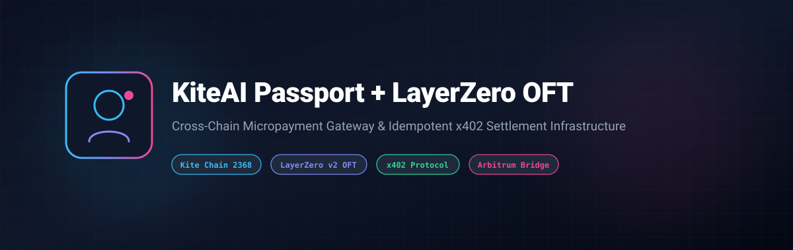
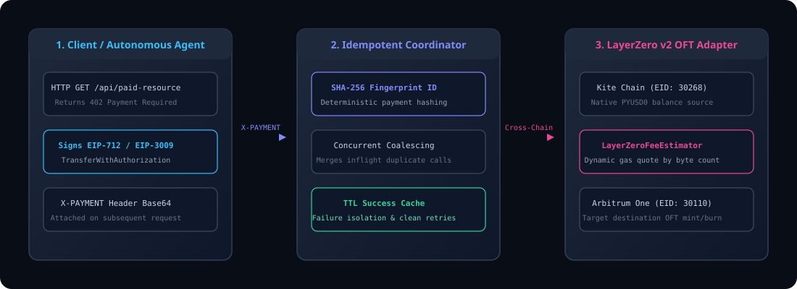

# KiteAI Passport + LayerZero OFT



[](LICENSE)
[](https://www.typescriptlang.org/)
[-0284c7)](https://gokite.ai)
[](https://layerzero.network)
[](https://gokite.ai)

An enterprise Node.js & TypeScript reference implementation combining **KiteAI Agent Passport** (x402 payment authorization) with **LayerZero v2 Omnichain Fungible Token (OFT)** cross-chain liquidity rails.

---

## 🌟 Key Capabilities

- **x402 Micropayment Interceptor**: Native implementation of `402 Payment Required`, EIP-712 / EIP-3009 payment signature parsing, and Facilitator settlement.
- **Idempotent Settlement Coordinator**: Generates deterministic SHA-256 fingerprints for payment authorizations, coalesces concurrent duplicate attempts, and maintains isolated cache TTLs to avoid double-charging.
- **LayerZero v2 OFT Adapter (`Pyusd0OftAdapter.sol`)**: Pre-configured cross-chain bridging contracts between Kite Chain (EID: `30268`) and Arbitrum (EID: `30110`).
- **Dynamic Fee Estimator (`LayerZeroFeeEstimator`)**: Real-time native gas quote computation based on cross-chain message payload size and destination endpoint verification.

---

## 🏗️ System Architecture



### End-to-End Execution Flow

1. **Client / Agent**: Requests protected resource via HTTP. Receives standard `402 Payment Required` response containing payee parameters and resource URI.
2. **Authorization**: The agent signs payment authorization (`TransferWithAuthorization`) and attaches the encoded Base64 payload in the `X-PAYMENT` header.
3. **Idempotency Engine**: Coordinates concurrent settlement attempts, verifies payment fingerprints, and delegates to the Kite Facilitator relay.
4. **Cross-Chain Bridge**: For multi-chain settlements, computes required LayerZero messaging fee via `LayerZeroFeeEstimator` and initiates OFT message delivery.

---

## 🚀 Quick Start

### Installation

```bash
cp .env.example .env
npm install
```

### Running Locally

```bash
# Start the development server
npm run dev

# Run automated tests (100% passing)
npm test

# Check LayerZero cross-chain configuration
npm run layerzero:check
```

---

## 🛡️ Idempotent Payment Processing

`/api/paid-resource` strictly decodes `X-PAYMENT` headers before contacting external facilitators:
- **Fingerprinting**: Uses SHA-256 digests of parsed authorizations as immutable local payment IDs.
- **In-flight Coalescing**: Concurrent identical requests share a single execution promise, preventing redundant on-chain transactions.
- **Cache Strategy**: Successful settlements are cached for 5 minutes (`SETTLEMENT_CACHE_MS`); failed settlements are never cached to permit immediate, safe retries.

---

## 📄 License

Licensed under the [Apache License, Version 2.0](LICENSE).
